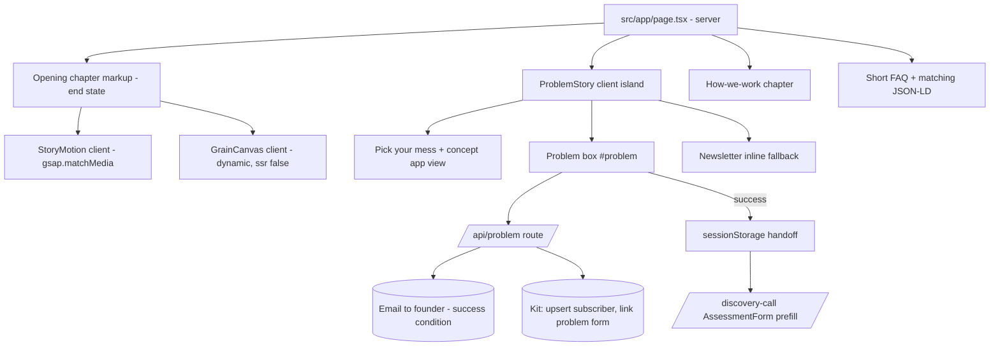
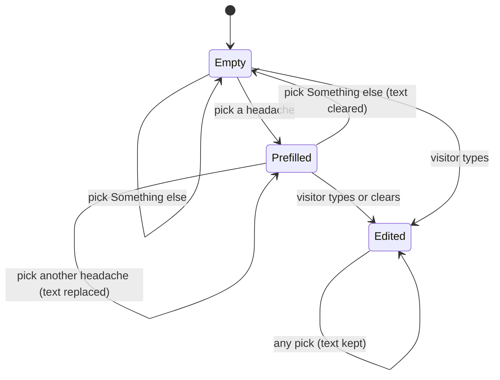

# Homepage Story Redesign - Plan

## Goal Capsule

- **Objective:** A growing Australian SME owner who lands on the homepage comes away thinking "this is something I can use to make my life easier" and tells Apprising their problem. The site itself reads as distinctly Apprising Creatives, not a template.
- **Product authority:** This Product Contract. `docs/trust-and-claims.md` remains the authority on any factual claim. Full narrative treatment for pages other than the homepage, and the `/for-agencies` story, are not active scope.
- **Means:** A server-rendered story homepage whose motion only enhances a complete static page (KTD1, KTD2), feeding a dedicated problem-send path into Kit (KTD7).
- **Open blockers:** None for building. Launch needs the founder to set up the email service (account, verified domain, key) and the Kit "problem" form and custom fields (see Dependencies / Assumptions).
- **Stop conditions:** Stop and ask if a change would alter a Product Contract requirement, add a factual trust claim without a row in `docs/trust-and-claims.md`, or need a CSP widening beyond what KTD3 and KTD4 state.
- **Who finishes:** `ce-work` implements and verifies the units; the founder does the Kit dashboard setup and the final palette and copy sign-off.

---

## Product Contract

### Summary

Rebuild the homepage as a scroll-driven story in AIDA chapters. It opens with a "paper chaos to app" moment: scattered spreadsheets, sticky notes, receipts and messages fly into one simple concept app on a phone. A "pick your mess" chapter lets the visitor choose their biggest headache, and the story ends at a three-field problem box pre-filled with that choice. The whole visual identity except the logo is redesigned, and the other pages adopt the new look with light motion.

### Problem Frame

The founder's read is that the current homepage looks like a generic "vibe-coded" site. It is dark navy with a teal accent, uses diagram-style visuals, and stacks eleven standard sections. Nothing about it shows the creativity the name "Apprising Creatives" promises.

It also asks a lot before it gives anything. The primary action is booking a free 20-minute assessment call. A cautious SME owner who hasn't yet pictured their own business running better has little reason to commit to a call.

The site can't buy trust with social proof either. There are no people photos by choice. There is one verified client project. Testimonials, ratings, client counts and certifications are off-limits unless real (`docs/trust-and-claims.md`). So trust has to come from the visitor seeing themselves using the result.

### Key Decisions

- **The opening transformation is "paper chaos to app."** The founder compared three live motion studies and picked this one; the eye follows recognisable objects from a messy SME week into one phone app. Governs R2. (session-settled: user-directed — chosen over tangled-lines-to-flow and noise-to-calm shader studies: the founder judged all three live and preferred A)
- **The main action is "describe your problem," with the assessment second.** Governs R8, R9, R10, R23. (session-settled: user-directed — chosen over keeping the assessment booking as the primary CTA and over replacing it entirely: lower friction first, deeper commitment after)
- **The homepage gets the full story; other pages get the look only.** Governs R21. (session-settled: user-directed — chosen over whole-site full treatment and homepage-only: contains the size of the first round)
- **Everything visual can change except the logo.** Governs R16. (session-settled: user-directed — chosen over keeping the teal accent or the full current identity)
- **Conversion wins when an effect conflicts with the action.** Governs R17, R18. (session-settled: user-directed — chosen over showcase-first and a per-section balance)
- **The homepage is restructured into story chapters, not restyled section by section.** Governs R1, R22. (session-settled: user-directed — chosen over keeping all eleven sections and over a trimmed restyle)
- **The Desire chapter is "pick your mess."** Governs R4, R5. (session-settled: user-directed — chosen over a day-in-the-life scroll, a tap-through demo, and leading with the real project)
- **The picked mess carries into the problem box.** Governs R6, R7. (session-settled: user-directed — chosen over tailoring only the wording and over keeping the chapters separate)
- **The problem box asks for name, email and problem only.** Governs R8. (session-settled: user-directed — chosen over email-plus-problem and over adding business name)
- **The newsletter checklist becomes a quiet fallback beside the action.** Governs R10. (session-settled: user-directed — chosen over moving it off the homepage and over keeping its own chapter)
- **No people imagery.** Governs R14. (session-settled: user-directed — chosen over real team photos now or a slot for later)
- **A "Something else" pick leaves the box empty.** Keeps non-trades visitors from being forced into the wrong pile. Governs R25. (session-settled: user-approved — proposed over a fixed six-item list: the list leans toward trades while industries are still being tested)
- **The assessment form arrives pre-filled after a problem send.** Removes retyping at the moment of highest intent without putting personal details in the URL. Governs R26. (session-settled: user-approved — proposed over a blank assessment form and over query-string prefill)
- **A send only succeeds when the founder will be notified.** Keeps "a real person will read it" true. Governs R27. (session-settled: user-approved — proposed over reporting success when Kit saved the contact but did not link the form)
- **Every problem send emails the founder directly.** Kit form automations email subscribers, not the account owner, and a repeat send may not re-trigger them, so Kit alone cannot keep R27 true. Governs R27. (session-settled: user-directed — chosen over relying on a Kit automation verified at launch, and over reusing an existing Kit alert)
- **The sitewide header action is the problem box.** Governs R28. (session-settled: user-approved — proposed over keeping the header button on `/discovery-call`)
- **Relocated content gets its own "What We Can Build" page.** Gives the secondary CTA a real destination. Governs R29. (session-settled: user-approved — proposed over scattering it into the FAQ and other pages)
- **Trust comes from relatable ease, not proof badges.** The belief to land is "this is something I can use to make my life easier"; security stays a quiet supporting line. Governs R11.

### Requirements

**Story structure**

- R1. The homepage is a short sequence of chapters following AIDA: the mess becomes one system (Attention), pick your mess (Interest and Desire), how we work, and the problem box (Action).
- R2. The opening chapter shows recognisable SME mess (spreadsheets, sticky notes, receipts, texts, emails, calendar clashes) gathering into one concept app on a phone as the visitor scrolls, with the headline moving from the problem to the promise.
- R3. Every shader or scroll-driven motion moment advances the story; no effect exists only for decoration.

**Pick your mess**

- R4. The visitor can pick one headache from a short list of everyday operational problems.
- R5. Picking a headache shows how that part of the business would work in one simple system, on the concept app.
- R6. The picked headache pre-fills the problem box, and the visitor can edit or clear it.
- R7. Changing the pick updates the pre-fill unless the visitor has already edited the box text.
- R25. The pick list includes a "Something else" option that leaves the problem box empty.

**Action**

- R8. The problem box asks for name, email and the problem, all required, and nothing else.
- R9. After a successful send, the visitor sees that a real person will read it and reply, and is offered booking the free automation assessment as the next step.
- R10. The newsletter checklist signup is offered as a low-key fallback near the problem box ("not ready? get the checklist"), visually secondary to the box.
- R11. One plain line near the problem box states the security posture already approved in `docs/australian-market.md`, with no certification implied.
- R12. When a send fails, the visitor's text is kept and they are told what to do next.
- R26. A visitor who books the assessment after a successful send finds their name, email and problem already filled in, and those details never appear in a URL.
- R27. A send is reported as successful only when the founder will be notified of it; otherwise it is handled as a failure per R12, with the contact email shown.

**Trust and claims**

- R13. Anything shown on the concept app is labelled as a concept and uses no invented clients, metrics, testimonials or ratings, per `docs/trust-and-claims.md`.
- R14. The homepage uses no people imagery.
- R15. The "how we work" chapter states the honest approach (the simplest solution, including "you may not need new software") and links to the real case study on `/portfolio`.

**Visual identity**

- R16. The palette, typography, layout and section rhythm are redesigned; the logo is unchanged. The result is recognisably Apprising with the name removed, and avoids neon-AI styling, robots, generic AI imagery and decorative gradients.

**Motion, performance and access**

- R17. No effect delays, hides or slows the problem box or the send action.
- R18. On phones the story works with touch scrolling, and shader detail is reduced first when performance suffers.
- R19. With reduced motion requested, every chapter shows its complete end state statically and all content stays readable.
- R20. All chapters work by keyboard, meet WCAG AA contrast, and use semantic structure.

**Rest of the site**

- R21. Other pages adopt the new visual identity and light motion without their own narratives; the full assessment on `/discovery-call` keeps working as today.
- R22. Content cut from the homepage (Industries, Engineering Capabilities, What We Can Build) is relocated rather than lost. A short FAQ stays near the end of the homepage.
- R28. The header action on every page is "tell us your problem," leading to the homepage problem box.
- R29. Relocated content lives on a new "What We Can Build" page, and the secondary CTA "See What We Can Automate" and every existing link to that content point there.
- R30. Without JavaScript, every chapter is readable and the problem box offers an email link instead of a form that cannot send.
- R23. Project documentation reflects the new primary action and visual system, including `CLAUDE.md`, `docs/conversion-strategy.md`, `docs/landing-page.md`, `docs/design-system.md`, `docs/brand.md` and `docs/project-context.md`.

**Measurement**

- R24. Problem-box sends, the headache picked, and post-send assessment bookings are tracked as analytics events, so success can be compared against today's homepage.

### Key Flows

- F1. First visit to a problem sent
  - **Trigger:** An SME owner lands on the homepage.
  - **Steps:** They scroll through the mess gathering into one app. They pick a headache and see that part working in one system. They read how Apprising works. They reach the problem box already pre-filled with their headache, add a sentence, their name and email, and send.
  - **Outcome:** They see a human-reply confirmation and an offer to book the assessment.
  - **Covered by:** R1, R2, R4, R5, R6, R8, R9
- F2. Not ready to talk
  - **Trigger:** The visitor reaches the problem box but doesn't want to describe a problem yet.
  - **Steps:** They take the checklist fallback instead.
  - **Outcome:** They join the newsletter and get the checklist; nothing is sent as a problem.
  - **Covered by:** R10
- F3. Reduced motion
  - **Trigger:** The visitor's device requests reduced motion.
  - **Steps:** Each chapter renders in its end state with no scroll-driven animation or moving shader.
  - **Outcome:** The full story and the problem box are readable and usable.
  - **Covered by:** R19

### Acceptance Examples

- AE1. **Covers R6, R7.** Given a visitor picked "Quotes," when they reach the box, it already mentions quotes. If they go back and pick "Invoices" without editing the box, it now mentions invoices.
- AE2. **Covers R7.** Given a visitor picked "Quotes" and then typed their own text into the box, when they pick "Invoices," their typed text is kept.
- AE3. **Covers R6, R8.** Given a visitor never picked a headache, when they reach the box, the problem field is empty and still required.
- AE4. **Covers R12.** Given a send fails, when the error shows, the name, email and problem text are still in the form.
- AE6. **Covers R25.** Given a visitor picks "Something else," when they reach the box, the problem field is empty.
- AE7. **Covers R26.** Given a visitor sent a problem and clicks the assessment offer, when `/discovery-call` loads in the same tab, name, email and the problem (in the biggest-challenge field) are filled in and the URL holds none of them.
- AE8. **Covers R27, R12.** Given the notification email to the founder cannot be sent, when the send returns, the visitor sees the failure message with the contact email and their text is still in the form, even if Kit saved the contact.
- AE5. **Covers R17, R18.** Given a mid-range phone on a slow connection, when the visitor scrolls straight to the box, they can type and send without waiting for any effect to finish.

### Success Criteria

- More visitors send a problem than send assessment requests from today's homepage. Conversion is the primary signal (R24). Until an analytics tool is connected, compare Kit subscriber counts on the problem form against the assessment form.
- The people who write in are real SMEs with real operational problems.
- Prospects mention the site unprompted on calls.
- The founder can show the site to clients and agencies as proof of creative and technical skill. When this pulls against conversion, conversion wins.

### Scope Boundaries

**Deferred for later**

- Full narrative treatment for `/about`, `/portfolio`, `/discovery-call` and `/for-agencies`.
- People imagery, testimonials and any new proof points beyond the one verified case study.
- A tap-through interactive demo app or a day-in-the-life scroll.

**Outside this work**

- Changing the assessment's own fields or process on `/discovery-call`.
- Any change to the logo.

**Deferred to Follow-Up Work**

- Connecting an analytics tool (GTM or GA4), including its CSP additions, once the founder supplies an ID.

**Considered and not built**

- CAPTCHA on the problem box: adds friction against R17; a hidden trap field and length limits cover the realistic spam risk. Revisit if Kit fills with junk contacts.
- Per-IP rate limiting on the problem route: a flood could use up the Kit API key the other forms share, but an in-memory limiter is unreliable on serverless hosting and the site's traffic is small. Revisit if Kit returns rate-limit errors or the logs show repeated sends from one source.
- A test runner: the repo has none and adding one is outside this work; verification is lint, type-check, build and the manual matrix in the Verification Contract. Revisit if the pre-fill or send logic grows.
- Pinned ScrollTrigger sections: a sticky stage gives the same effect without page-height jumps (KTD2). Revisit only if real devices show sticky failing.

### Dependencies / Assumptions

- "The current site looks generic" is the founder's own read, not visitor feedback. No visitor reaction has been recorded.
- The pick-your-mess list is assumed to start from the prototype's six piles: jobs, quotes, invoices, messages, timesheets and stock. These lean toward trades and field-service businesses, while target industries are still being tested (`docs/australian-market.md`).
- Problem-box sends reach the founder as a direct email through a transactional email service (Resend assumed). The founder must create the account, verify a sending domain, and supply the API key before launch.
- The founder must create, before launch, a Kit form for problem sends plus custom fields `problem` and `problem_headache`; Kit rejects unknown field keys (`.env.example`).
- No analytics tool is connected today, so `trackEvent` records nothing in production (`src/lib/analytics.ts`); R24 events are wired but produce data only once a tool is added.
- The pick-your-mess list starts from the six piles plus "Something else"; final wording is confirmed with the founder during implementation.

### Outstanding Questions

**Deferred to Implementation**

- Final pick-your-mess labels and pre-fill wording, confirmed with the founder (U4).
- Final palette values and type scale, tuned against contrast checks and signed off by the founder (U1).
- Which analytics tool to connect and its ID (follow-up; see Scope Boundaries).

### Sources / Research

- Product Contract preservation: changed — added R25 to R30 and AE6 to AE8, confirmed by the founder in the plan scoping summary on 2026-10-27; AE8 then re-pointed from the Kit form link to the direct notification email after the founder chose direct email during document review; R1 to R24 unchanged.

- Chosen motion study: `.context/compound-engineering/ce-prototype/2026-10-27-mess-to-clean/01-transformation/screens/001-a-paper-to-app.html`, with the run summary in `.context/compound-engineering/ce-prototype/2026-10-27-mess-to-clean/decisions.md`. Its palette, fonts, copy and app contents are placeholders.
- Current homepage section order: `src/app/page.tsx`; spec in `docs/landing-page.md`.
- Current primary CTA: `src/lib/constants.ts` (`bookDiscoveryCall`), used by `src/components/sections/Hero.tsx`.
- Assessment intake and required fields: `src/app/api/assessment/route.ts`, `docs/conversion-strategy.md`.
- Newsletter and checklist: `src/app/api/subscribe/route.ts`, `src/lib/content/leadMagnet.ts`.
- Analytics: `src/lib/analytics.ts` and the event list in `docs/conversion-strategy.md`.
- Claims register: `docs/trust-and-claims.md`. Security wording: `docs/australian-market.md`.
- Current tokens and the existing reduced-motion pattern: `src/app/globals.css`, `src/components/visuals/RevealOnScroll.tsx`.

---

## Planning Contract

### Key Technical Decisions

- KTD1. **The server renders every chapter in its finished state; motion only adds a start state.** This follows the repo rule in `src/components/visuals/RevealOnScroll.tsx` and `src/app/globals.css`, so no-JS, reduced-motion and slow-hydration visitors all get readable content (R19, R30). Motion is set up from `gsap.matchMedia` with three branches: wide screens with motion allowed get the full story, narrow screens with motion allowed get a shorter version, and reduced motion gets nothing. Hidden start states are never in base CSS. A tiny inline script in `src/app/layout.tsx` (allowed by the CSP's `script-src 'unsafe-inline'`) adds a `motion` class to `<html>` before first paint when reduced motion is not requested. CSS under `html.motion` reserves the track height and sets the opening chapter's start state, so the page neither grows nor flashes the ending after hydration. No-JS and reduced-motion visitors never get the class.
- KTD2. **The opening chapter uses a CSS sticky stage plus a scrubbed ScrollTrigger, without `pin`.** A tall track holds a `position: sticky` 100svh stage, and ScrollTrigger only reads progress. This avoids pin-spacer height changes after hydration, which would break cold loads on `/#problem`, back-navigation and in-page anchors. The track gets its extra height from the pre-paint `html.motion` class (KTD1), so its height is final before first paint. `ScrollTrigger.config({ ignoreMobileResize: true })` and `svh` units handle the mobile address bar (R18).
- KTD3. **GSAP comes from npm (`gsap` 3.15.x, `@gsap/react` 2.1.x) and is only imported from client components.** Use `useGSAP` for cleanup and register plugins once in the motion module. The CSP (`next.config.ts`) blocks CDNs, and GSAP needs no CSP change. GSAP's standard licence is no-charge for this use; record the licence check in `docs/project-context.md`. Remove `html { scroll-behavior: smooth }` from `src/app/globals.css`, because it fights ScrollTrigger; anchors keep `scroll-margin-top`.
- KTD4. **The paper-grain shader is raw WebGL, loaded after first paint, with a CSS fallback.** It is one fullscreen triangle with DPR capped at 1.5. It pauses offscreen (IntersectionObserver) and on `visibilitychange`, handles `webglcontextlost`, and draws one still frame under reduced motion. It loads through `next/dynamic` with `ssr: false`, called inside the `StoryMotion` client module (Next only allows `ssr: false` in client components), so it never blocks the hero or the problem box (R17). When WebGL is unavailable, a static CSS paper texture shows instead. Narrow screens render it at reduced resolution, and the grain is the first thing dropped if frames lag (R18). No CSP change is needed.
- KTD5. **Colour tokens are renamed by role, not colour.** The `@theme` block in `src/app/globals.css` moves from `deep-navy`/`teal`-style names to role names: surface, raised surface, ink, muted ink, line, accent, accent-strong and a dark inverse surface. Every component switches to them in the same change. The `onDark` props on primitives stay, but map to the inverse tokens. `src/app/opengraph-image.tsx` and `src/app/icon.tsx` hard-code hex values and are updated by hand.
- KTD6. **Typography moves to Bricolage Grotesque (display) and Instrument Sans (body) through `next/font/google`.** This continues the chosen prototype's direction. `next/font` self-hosts, so the CSP's `font-src 'self'` holds. It replaces Manrope and Inter in `src/app/layout.tsx`. (session-settled: user-approved — proposed in the plan scoping summary as the starting direction, with final tuning during the build)
- KTD7. **Problem sends go through a new route, `src/app/api/problem/route.ts`, modelled on `src/app/api/assessment/route.ts`.** Step 1 sends the founder a notification email (name, email, headache, full problem text, reply-to set to the visitor) through the Resend REST API with plain `fetch`, matching how the repo already calls Kit, so no new package is needed. That email is the success condition for R27; when it fails, the route returns 502. Step 2 records the contact in Kit: upsert with `first_name` and the custom fields `problem` and `problem_headache` (never `biggest_challenge`), then link to `KIT_PROBLEM_FORM_ID`. Kit failures after a sent email are logged, not reported to the visitor, because the founder already has the message. The email also keeps every repeat send, which the single Kit field cannot. All calls are server-side, so the CSP is unaffected. The server validates name (up to 100 characters), email and problem (10 to 2,000 characters). A filled honeypot field gets a success-shaped response without a Kit call, and every trap hit is logged server-side so a wrongly trapped real visitor shows up in the logs. The honeypot uses a non-semantic name with `autocomplete="off"`, `tabindex="-1"` and `aria-hidden`, so browsers don't autofill it.
- KTD8. **One client island owns pick-your-mess and the problem box.** Chapter copy stays server-rendered and passed in as children. The pre-fill follows the state model in High-Level Technical Design: a pick writes a starter sentence until the visitor edits the box. Clearing the box counts as an edit. "Something else" writes nothing and never clears text the visitor typed (R6, R7, R25). The island renders the how-we-work chapter, passed in as server-rendered children, between the pick and the box, so the page order in U6 holds. Before any pick, and for "Something else", the concept app shows its all-in-one "Today" overview.
- KTD9. **The assessment handoff uses `sessionStorage`.** After a successful send, the island stores `{ name, email, problem }` under one key. `src/components/sections/AssessmentForm.tsx` reads it once in an effect, writes the values straight into its uncontrolled input elements (no state update, which the repo's React hooks lint rules flag), and deletes the key. Nothing goes in the URL (R26). When the key is missing, the form stays blank as today.
- KTD10. **Hash targets survive the restructure.** `#problem` sits on the box, outside the sticky track. `#how-we-work` moves to the how-we-work chapter. Links to `/#solutions` and `/#what-we-do` are repointed to `/what-we-can-build` (R29). After fonts load, the motion module calls `ScrollTrigger.refresh()` and, if `location.hash` is set, scrolls the target into view once. A skip link before the story jumps to `#problem` (R17, R20).
- KTD11. **The FAQ schema is built from the same items the page shows.** `buildFaqJsonLd` in `src/lib/seo.ts` takes an `items` argument, and `src/app/page.tsx` passes the same short list to it and to `Faq`.
- KTD12. **Analytics events are extended without personal data.** The `AnalyticsEvent` union in `src/lib/analytics.ts` gains `headache_picked`, `problem_submitted` and `problem_failed`. `discovery_call_clicked` gains a `source` property, carried by a new `analyticsData` prop on `Button`. Payloads carry the headache key and an edited flag, never name, email or problem text (R24).

### High-Level Technical Design

Homepage composition. Server components render all copy; the client pieces only enhance.



Problem send sequence (R12, R27):

```mermaid
sequenceDiagram
  participant V as Visitor
  participant B as Problem box
  participant R as /api/problem
  participant E as Email service
  participant K as Kit
  V->>B: Send (name, email, problem)
  B->>B: Disable button, keep values
  B->>R: POST JSON incl. headache key and honeypot
  R->>R: Validate; honeypot filled returns ok without Kit
  R->>E: Notification email to founder
  alt email fails
    R-->>B: 502 (founder would not be notified)
  else email sent
    R->>K: Upsert subscriber with problem fields, link problem form
    Note over R,K: Kit failure is logged only
    R-->>B: 200
  end
  B-->>V: Success view + assessment offer, or error with contact email and values kept
```

Problem-box pre-fill state (R6, R7, R25, AE1, AE2, AE3, AE6):



Motion modes (KTD1, KTD2, KTD4):

| Condition | Opening chapter | Grain shader | Pick / box |
|---|---|---|---|
| No JS | Finished state, normal height | CSS texture | Pick list readable, email link instead of form (R30) |
| Reduced motion | Finished state, normal height | One still frame | Works, no transitions |
| Motion, width ≥ 768px | Sticky stage, full scrubbed gather | Animated, DPR ≤ 1.5 | Short non-scrubbed transitions |
| Motion, width < 768px | Sticky stage, shorter track, fewer objects | Half resolution, dropped first if frames lag | Same as above |

### Assumptions

- The founder confirms the final pick labels, palette values and headline copy during implementation; the plan's defaults come from the chosen prototype.
- Kit custom fields accept a few thousand characters; the server caps the problem at 2,000 characters until checked against Kit's limits.
- Resend is the email service; any provider with a simple HTTPS send API works the same way if the founder prefers another.

### System-Wide Impact

- **Every component's styling:** KTD5 renames tokens used across `src/components` and `src/app`; U1 changes them in one pass so the site never ships half-renamed.
- **Links and SEO:** removing homepage sections changes anchors used by nav, footer, capability cards and outside bookmarks (KTD10, U7). The new route enters `sitemap.ts`. FAQ structured data shrinks with the visible FAQ (KTD11).
- **Email:** a new outbound email path to the founder; it needs a verified sending domain, which also affects the domain's DNS records.
- **Kit list:** problem sends add a third Kit form and two custom fields. Shared subscriber records mean one contact can carry problem, assessment and newsletter data at once; only the problem fields are new (KTD7).
- **Security headers:** nothing in this plan widens the CSP (KTD3, KTD4); a future analytics tool will.
- **Assessment page:** gains a read of `sessionStorage` on mount and nothing else (KTD9).

### Risks

| Risk | Decision |
|---|---|
| Email service not set up before launch, so every send fails | Launch checklist in `docs/project-context.md` (U11) covering the Resend account, verified domain, keys, and one live test send; U3 returns 503 with a clear log line when keys are missing |
| Kit form or fields missing, so contacts aren't recorded in Kit | Founder still gets every email; Kit errors are logged and the same launch checklist covers the Kit setup |
| Scroll story janks on low-end phones | Shorter track and fewer objects under 768px; grain at half resolution and dropped first (KTD4); verified on real devices |
| Hydration changes layout and shifts content | Sticky stage instead of pinning (KTD2); Lighthouse CLS gate under 0.1 |
| New palette fails contrast in some pairing | Contrast gate per token pair (U1, Verification Contract) |
| Spam fills the Kit list through the open endpoint | Honeypot and length limits; CAPTCHA considered and not built (Scope Boundaries) |
| Success can't be measured because no analytics tool records events | Kit form counts as the interim measure (Success Criteria); tool connection is follow-up work |

### Sequencing

U1 and U2 set the visual foundation everything else uses. U3 (server route) can start in parallel with U1. U4 and U5 build the two homepage chapters. U6 assembles the homepage. U7 to U10 restyle and relink the rest of the site and can run in any order after U6. U11 documents the result last.

---

## Implementation Units

| U-ID | Title | Key files | Depends on |
|---|---|---|---|
| U1 | Visual foundation | `src/app/globals.css`, `src/app/layout.tsx`, `src/components/ui/*` | none |
| U2 | Site chrome and CTAs | `src/components/layout/*`, `src/lib/constants.ts`, `src/lib/content/nav.ts` | U1 |
| U3 | Problem send route | `src/app/api/problem/route.ts`, `.env.example` | none |
| U4 | Pick-your-mess and problem box island | `src/components/story/ProblemStory.tsx`, `src/lib/content/story.ts` | U1, U3 |
| U5 | Opening chapter with motion and grain | `src/components/story/OpeningChapter.tsx`, `StoryMotion.tsx`, `GrainCanvas.tsx` | U1 |
| U6 | Homepage assembly, FAQ and anchors | `src/app/page.tsx`, `src/lib/seo.ts` | U4, U5 |
| U7 | What We Can Build page and link repointing | `src/app/what-we-can-build/page.tsx`, `src/lib/content/capabilities.ts`, `src/app/sitemap.ts` | U1, U2 |
| U8 | Assessment pre-fill handoff | `src/components/sections/AssessmentForm.tsx` | U4 |
| U9 | Other pages adopt the new look | `src/components/ui/PageHero.tsx`, `src/app/{about,portfolio,discovery-call,for-agencies}/page.tsx` | U1, U2 |
| U10 | Analytics events | `src/lib/analytics.ts`, `src/components/ui/Button.tsx` | U4 |
| U11 | Documentation and claims register | `CLAUDE.md`, `docs/*.md` | U1 to U10 |

### U1. Visual foundation

- **Goal:** Replace the palette, type and primitives with the new identity so every later unit builds on it.
- **Requirements:** R16, R20; KTD5, KTD6, KTD3 (smooth-scroll removal).
- **Dependencies:** none.
- **Files:** `src/app/globals.css`, `src/app/layout.tsx`, `src/components/ui/Section.tsx`, `src/components/ui/Container.tsx`, `src/components/ui/Button.tsx`, `src/components/ui/Card.tsx`, `src/components/ui/Badge.tsx`, `src/components/ui/SectionHeading.tsx`, `src/components/ui/Logo.tsx`, `src/app/opengraph-image.tsx`, `src/app/icon.tsx`, plus every component that uses the old colour utilities.
- **Approach:**
  1. Define role-named tokens in `@theme`, starting from the prototype palette (warm paper, ink, logo-derived teal). Check each text/background pair for AA contrast before use.
  2. Swap fonts in `layout.tsx` to Bricolage Grotesque and Instrument Sans via `next/font/google`, keeping the CSS variable pattern.
  3. Replace old colour utilities across the codebase with the role tokens in one pass, so no old name remains.
  4. Add a submit-button style export next to `Button` so forms stop duplicating button classes.
  5. Remove `html { scroll-behavior: smooth }`; keep the reduced-motion base layer and focus-visible styles.
  6. Keep the logo PNGs unchanged; set the wordmark colours in `Logo.tsx` explicitly so they don't drift with the palette.
- **Patterns to follow:** the existing `@theme` token block and `next/font` variable wiring; the `Section` tone map.
- **Test expectation:** none — styling and tokens; covered by the build and the visual and contrast checks in the Verification Contract.
- **Verification:** no old colour token name remains in `src`; every page builds; contrast checks pass for body text, muted text, buttons and focus rings on each tone.

### U2. Site chrome and CTAs

- **Goal:** Make the header, mobile nav and footer carry the new look and the new primary action.
- **Requirements:** R28, R23 (constants); Key Decision on header action.
- **Dependencies:** U1.
- **Files:** `src/components/layout/Navbar.tsx`, `src/components/layout/MobileNav.tsx`, `src/components/layout/Footer.tsx`, `src/lib/constants.ts`, `src/lib/content/nav.ts`.
- **Approach:**
  1. Add a `tellUsProblem` CTA (label "Tell us your problem", href `/#problem`) to `CTA_LABELS`/`CTA_HREFS`; keep `bookDiscoveryCall` for the post-send offer and other existing uses.
  2. Point the header and mobile-nav button at the new CTA, and keep a compact version of the button visible in the mobile header outside the menu (R28). Release the mobile-nav body scroll lock before the hash navigation runs.
  3. Update nav and footer links: "What We Can Build" goes to `/what-we-can-build`; "Contact" goes to `/#problem`; "How we work" stays `/#how-we-work`.
  4. Change `exploreWhatWeBuild` to `/what-we-can-build`.
- **Patterns to follow:** existing `CTA_LABELS`/`CTA_HREFS` constants and `NAV_LINKS`.
- **Test scenarios:**
  - From `/about`, clicking the header button lands on the homepage scrolled to the problem box.
  - On a phone, opening the mobile menu and tapping the button closes the menu and scrolls to the box.
  - "See What We Can Automate" anywhere on the site opens `/what-we-can-build`.
- **Verification:** no link in nav, footer or constants points at `#solutions`, `#what-we-do` or `#final-cta`.

### U3. Problem send route

- **Goal:** A server endpoint that stores a problem send in Kit and reports success only when the founder will be notified.
- **Requirements:** R8, R12, R27; KTD7.
- **Dependencies:** none.
- **Files:** `src/app/api/problem/route.ts`, `.env.example`.
- **Approach:**
  1. Copy the structure of `src/app/api/assessment/route.ts`: JSON parse guard, `asString`, `EMAIL_PATTERN`, env checks returning 503.
  2. Require name, email and problem (problem 10 to 2,000 characters). Accept an optional headache key from the known list.
  3. If the honeypot field is non-empty, return a success-shaped 200 without calling Kit.
  4. Send the founder notification email per KTD7; a failure returns 502.
  5. Then upsert the Kit subscriber with `problem` and `problem_headache` and link to `KIT_PROBLEM_FORM_ID`, logging any Kit failure without changing the response.
  6. Document `RESEND_API_KEY`, `PROBLEM_NOTIFY_TO`, `PROBLEM_NOTIFY_FROM`, `KIT_PROBLEM_FORM_ID` and the two Kit custom fields in `.env.example`.
- **Patterns to follow:** `src/app/api/assessment/route.ts`, `src/app/api/subscribe/route.ts`.
- **Test scenarios:**
  - Valid name, email and 40-character problem returns 200, the founder receives an email with the full problem and a reply-to of the visitor, and the subscriber appears on the problem form with both fields set.
  - Two sends from the same email produce two founder emails, each with its own problem text.
  - Email service returns an error: route returns 502 and makes no Kit call.
  - Email sent but Kit upsert fails: route returns 200 and logs the Kit error.
  - Missing name, invalid email, or a 5-character problem each returns 400 with a message naming the problem.
  - A 2,001-character problem or a 101-character name returns 400.
  - Filled honeypot returns 200, makes no Kit call, and writes a log line.
  - Missing `RESEND_API_KEY` or `PROBLEM_NOTIFY_TO` returns 503.
  - Covers AE8. Email service fails after validation: returns 502 and the client keeps the visitor's text.
  - An email already on the assessment form keeps its `biggest_challenge` value after a problem send.
- **Verification:** each scenario reproduced with a local request against a Kit test key, or against a stubbed fetch when no key is available.

### U4. Pick-your-mess and problem box island

- **Goal:** The Interest/Desire and Action chapters: pick a headache, see it in the concept app, send the problem, fall back to the checklist.
- **Requirements:** R4, R5, R6, R7, R8, R9, R10, R11, R12, R13, R17, R20, R25, R26 (writing the handoff), R27, R30; KTD8, KTD9; F1, F2.
- **Dependencies:** U1, U3.
- **Files:** `src/components/story/ProblemStory.tsx`, `src/components/story/ConceptApp.tsx`, `src/components/story/NewsletterInline.tsx`, `src/lib/content/story.ts`.
- **Approach:**
  1. Put the headache list (six piles plus "Something else"), each pile's concept-app view, starter sentences, box copy, the security line (wording from the FAQ answer in `src/lib/content/faq.ts`) and the human-reply copy in `src/lib/content/story.ts`.
  2. Render the picks as a radio group with a polite live region announcing the concept-app change. The concept app carries the "Concept" `Badge` (R13).
  3. Make the box a controlled form following the state diagram, with `method="post"` and the send button disabled until hydration, so an early submit can never put details in a URL. Send via the U3 route with the button disabled while in flight and a request timeout.
  3a. Show the route's validation message next to the form on a 400. On a 5xx, timeout or network failure, show the general failure message with the contact email (R12).
  4. On success, replace the form with the confirmation, move focus to its heading, write the KTD9 handoff, and show the assessment offer using `CTA_HREFS.bookDiscoveryCall`.
  5. On failure, keep values and show the error with `CONTACT_EMAIL` (R12, R27).
  6. Extract the newsletter form logic from `src/components/sections/Newsletter.tsx` into `NewsletterInline`, visually secondary to the box, with no shared fields.
  7. Render a `<noscript>` email link in place of the form (R30); the pick list stays readable as plain content.
- **Patterns to follow:** `AssessmentForm.tsx` (status states, `role="status"`/`role="alert"`, `useId` labels); `Newsletter.tsx` (delayed-message honesty); content-as-`as const` objects in `src/lib/content/`.
- **Test scenarios:**
  - Covers AE1. Pick "Quotes", the box mentions quotes; pick "Invoices" without typing, the box mentions invoices.
  - Covers AE2. Pick "Quotes", type a sentence, pick "Invoices": the typed text stays.
  - Covers AE3. No pick: the problem field is empty and sending is blocked until filled.
  - Covers AE6. Pick "Something else": the box is empty.
  - Clearing a pre-filled box then picking again leaves it empty (clearing counts as an edit).
  - Covers AE4. Send with the route returning 502: name, email and problem remain, error shows the contact email.
  - Double-clicking send makes one request.
  - Pressing Enter in a field before the page hydrates does not submit or change the URL.
  - A 400 shows the route's validation message; a timeout shows the failure message with the contact email.
  - Before any pick, and after "Something else", the concept app shows the overview.
  - Success moves focus to the confirmation heading, announces it, and shows the assessment offer.
  - Signing up via the checklist fallback never sends a problem.
  - Keyboard only: arrow keys move through picks, Tab reaches each field and the send button in order.
  - With JS disabled, the email link shows and no dead form is rendered.
- **Verification:** all scenarios pass in a desktop and a phone-width browser; the concept app shows the Concept label for every pile.

### U5. Opening chapter with motion and grain

- **Goal:** The "paper chaos to app" chapter, server-rendered finished and animated only where motion is allowed.
- **Requirements:** R2, R3, R13, R14, R17, R18, R19, R20; KTD1, KTD2, KTD3, KTD4.
- **Dependencies:** U1.
- **Files:** `src/components/story/OpeningChapter.tsx`, `src/components/story/StoryMotion.tsx`, `src/components/story/GrainCanvas.tsx`, `src/lib/content/story.ts`, `src/app/layout.tsx` (pre-paint motion class), `src/app/globals.css`, `package.json`.
- **Approach:**
  1. Add `gsap` and `@gsap/react` as dependencies.
  2. Server-render the chapter in its finished state: promise headline as the page's single `h1`, the problem line as supporting copy, the concept app with all rows, and the mess objects present in the DOM but laid out as a tidy "before" strip, marked up as a labelled list so screen readers hear them once. Port object content from the prototype.
  3. In `StoryMotion`, use `useGSAP` with `gsap.matchMedia` branches per the motion-modes table. Add the track-height class, set the mess start state, and build one scrubbed timeline that flies each object into its row, swaps the headline emphasis and calms the grain.
  3a. Size the stage content to fit within 100svh. When the viewport is shorter than 560px (landscape phones), use the reduced-motion layout instead.
  4. Compute object targets from layout offsets, not transformed rects, with `invalidateOnRefresh`. Refresh after `document.fonts.ready`.
  5. Build `GrainCanvas` per KTD4 and load it from `StoryMotion` with `next/dynamic` and `ssr: false`; expose a progress input so the timeline drives the grain intensity.
- **Patterns to follow:** the chosen prototype `001-a-paper-to-app.html` (object set, timing, offset math); `RevealOnScroll.tsx` (end-state-first principle).
- **Test scenarios:**
  - Reduced motion: the chapter shows the finished app and headline with normal page height and no animation.
  - JS disabled: the same finished state renders, and the mess objects are readable as a tidy strip.
  - Desktop with motion: scrolling through the track gathers every object into its row; scrolling back reverses it.
  - Phone width with motion: the shorter track plays with fewer objects and no horizontal overflow at 360px.
  - Resizing between 767px and 768px switches modes without leaving objects stranded.
  - A landscape phone (under 560px tall) shows the static finished chapter.
  - First paint with motion allowed already shows the mess start state and full track height; nothing jumps when hydration finishes.
  - WebGL unavailable: the CSS texture shows and nothing errors.
  - Tab hidden: the grain loop stops.
  - Cold load on `/#problem` lands on the box, not mid-story.
- **Verification:** all scenarios observed in Chrome and Safari (iOS for the phone case); Lighthouse CLS on the homepage stays under 0.1.

### U6. Homepage assembly, FAQ and anchors

- **Goal:** Compose the homepage chapters in story order with the how-we-work chapter, short FAQ and working anchors.
- **Requirements:** R1, R15, R17, R20, R22 (short FAQ); KTD10, KTD11.
- **Dependencies:** U4, U5.
- **Files:** `src/app/page.tsx`, `src/components/story/HowWeWork.tsx`, `src/lib/seo.ts`, `src/lib/content/faq.ts`, `src/lib/content/process.ts`.
- **Approach:**
  1. Order: skip link, opening chapter, pick-your-mess, how-we-work, problem box with fallback, short FAQ.
  2. Build how-we-work from `PROCESS_TRUST_NOTES` and the process steps, with a link to `/portfolio` (R15).
  3. Choose a short FAQ subset and pass the same array to `Faq` and `buildFaqJsonLd(items)`.
  4. Remove the old homepage sections (Hero, Problem, Capabilities, SolutionExamples, Process, Industries, TechCapabilities, WhyApprising, Newsletter, FinalCta) from `page.tsx`; delete components that end up unused anywhere.
  5. Add the hash re-scroll after refresh per KTD10.
- **Patterns to follow:** current `page.tsx` JSON-LD placement; `Section`/`Container` composition.
- **Test scenarios:**
  - Homepage renders exactly one `h1` and headings in order.
  - The FAQ JSON-LD lists the same questions the page shows.
  - From the homepage, the in-page "How we work" nav link lands on that chapter while the story is mid-scroll.
  - Back from `/discovery-call` returns to the previous position without the story jumping.
  - The skip link moves focus to the problem box.
- **Verification:** a production build has no unused-import warnings and the homepage passes an axe scan with no serious issues.

### U7. What We Can Build page and link repointing

- **Goal:** Give relocated content a home and keep every old link working.
- **Requirements:** R22, R29.
- **Dependencies:** U1, U2.
- **Files:** `src/app/what-we-can-build/page.tsx`, `src/lib/content/capabilities.ts`, `src/app/sitemap.ts`, `src/components/sections/Capabilities.tsx`, `src/components/sections/SolutionExamples.tsx`, `src/components/sections/Industries.tsx`.
- **Approach:**
  1. Create the page with page metadata and canonical URL, composing Capabilities, SolutionExamples (keeping `id="solutions"` and Concept badges) and Industries (keeping its "being tested" note).
  2. Repoint `CAPABILITIES[*].anchor` to `/what-we-can-build#solutions`.
  3. Add the route to `sitemap.ts`.
  4. Leave TechCapabilities (Engineering Capabilities) where it already renders on `/for-agencies`; it needs no new home (R22).
  5. Add a homepage hash shim: if the homepage loads with `#solutions` or `#what-we-do`, replace the location with `/what-we-can-build` and the matching hash.
- **Patterns to follow:** existing page files such as `src/app/about/page.tsx` (metadata, sections).
- **Test scenarios:**
  - `/what-we-can-build` renders all three sections with Concept badges and the industries disclaimer.
  - A bookmark to `/#solutions` ends on `/what-we-can-build#solutions`.
  - Capability links scroll to the examples on the new page.
- **Verification:** sitemap lists the new route; no internal link points at a removed anchor.

### U8. Assessment pre-fill handoff

- **Goal:** People moving from a sent problem to the assessment don't retype anything.
- **Requirements:** R26, R21; KTD9.
- **Dependencies:** U4.
- **Files:** `src/components/sections/AssessmentForm.tsx`.
- **Approach:**
  1. In an effect, read the handoff key from `sessionStorage` inside try/catch, write name, email and problem into the form's input elements (problem goes in the biggest-challenge field), then remove the key (KTD9).
  2. Leave every other field, the validation and the submit path unchanged.
- **Patterns to follow:** the form's existing uncontrolled inputs.
- **Test scenarios:**
  - Covers AE7. After a problem send in the same tab, `/discovery-call` shows name, email and problem filled, and the URL has no query string.
  - Opening `/discovery-call` directly shows a blank form.
  - Reloading `/discovery-call` after the handoff shows a blank form (key consumed).
  - With storage blocked, the form renders blank without errors.
- **Verification:** assessment submissions still reach Kit with the existing fields.

### U9. Other pages adopt the new look

- **Goal:** `/about`, `/portfolio`, `/discovery-call` and `/for-agencies` match the new identity with light motion.
- **Requirements:** R21, R16, R19.
- **Dependencies:** U1, U2.
- **Files:** `src/components/ui/PageHero.tsx`, `src/app/about/page.tsx`, `src/app/portfolio/page.tsx`, `src/app/discovery-call/page.tsx`, `src/app/for-agencies/page.tsx`, `src/components/sections/ForAgencies.tsx`, `src/components/sections/TechCapabilities.tsx`.
- **Approach:**
  1. Extract the four hand-copied page heroes into `PageHero`.
  2. Restyle each page's sections with the role tokens; reuse `RevealOnScroll` for light motion only.
  3. Do not add narratives, scroll stories or shaders to these pages.
- **Patterns to follow:** `RevealOnScroll.tsx`; existing page composition.
- **Test expectation:** none — restyling with no behavior change; covered by visual, contrast and reduced-motion checks.
- **Verification:** each page renders at 360px and 1440px without overflow; the for-agencies "Partner With Us" CTA still works.

### U10. Analytics events

- **Goal:** The new funnel emits events that can be compared once a tool is connected.
- **Requirements:** R24; KTD12.
- **Dependencies:** U4.
- **Files:** `src/lib/analytics.ts`, `src/components/ui/Button.tsx`, `src/components/story/ProblemStory.tsx`, `src/components/layout/Navbar.tsx`, `src/components/layout/MobileNav.tsx`.
- **Approach:**
  1. Extend the event union and add an `analyticsData` prop to `Button`.
  2. Fire `headache_picked` on pick change, and `problem_submitted` or `problem_failed` on send outcome, with `{ headache, edited }` only.
  3. Fire `discovery_call_clicked` with `source` from the post-send offer, and from the header and mobile-nav buttons where they still point at the assessment.
- **Patterns to follow:** existing `trackEvent` calls in `AssessmentForm.tsx` and `Newsletter.tsx`.
- **Test scenarios:**
  - With a stub `window.dataLayer`, a pick then a successful send pushes `headache_picked` then `problem_submitted` with the headache key and no name, email or problem text.
  - A failed send pushes `problem_failed`.
  - Clicking the post-send assessment offer pushes `discovery_call_clicked` with `source: "problem_success"`.
  - Without `dataLayer`, nothing errors.
- **Verification:** the TypeScript union rejects unknown event names at build time.

### U11. Documentation and claims register

- **Goal:** The docs describe the site that now exists, and every new claim is registered.
- **Requirements:** R23, R11, R13; trust rules in `CLAUDE.md`.
- **Dependencies:** U1 to U10.
- **Files:** `CLAUDE.md`, `docs/conversion-strategy.md`, `docs/landing-page.md`, `docs/design-system.md`, `docs/brand.md`, `docs/project-context.md`, `docs/trust-and-claims.md`, `docs/seo.md`.
- **Approach:**
  1. Update the primary CTA hierarchy (problem box first, assessment second, secondary CTA to `/what-we-can-build`) in `CLAUDE.md` and `docs/conversion-strategy.md`, including the new events.
  2. Rewrite `docs/landing-page.md` for the chapter order and `docs/design-system.md` for role tokens, fonts and motion modes; remove the superseded navy/teal overrides rather than stacking new ones.
  3. Add register rows to `docs/trust-and-claims.md` for "a real person reads every message" and the security line.
  4. Record in `docs/project-context.md` the problem route, Kit setup steps, GSAP licence check and the analytics gap; add the new page to `docs/seo.md`.
- **Test expectation:** none — documentation only.
- **Verification:** no doc still names "Book a Free Automation Assessment" as the primary CTA or describes the old palette as current.

---

## Verification Contract

| Gate | Command or method | Applies to |
|---|---|---|
| Lint | `npm run lint` | every unit |
| Types | `npx tsc --noEmit` | every unit |
| Build | `npm run build` | every unit |
| Accessibility | axe browser scan, keyboard-only pass, screen-reader pass on pick and send | U4, U5, U6, U9 |
| Contrast | check each token pair at AA | U1, U9 |
| Motion modes | Chrome DevTools emulation of reduced motion; JS disabled; widths 360, 767, 768, 1440 | U5, U6 |
| Real phone | iOS Safari and Android Chrome scroll through the story, address-bar show and hide, soft keyboard on the box | U4, U5 |
| Network | slow 3G throttling on send, and offline send | U4 |
| Performance | Lighthouse mobile on `/`: CLS < 0.1, and the problem box usable before the grain loads | U5, U6 |
| Kit and email | local sends against Kit and Resend test keys, or stubbed fetch when none is available; one live send before launch | U3, U8 |

There is no automated test runner; each unit's test scenarios are run by hand against a dev or production build.

---

## Definition of Done

- Every unit's verification passes and every gate in the Verification Contract applies cleanly to the units it names.
- Acceptance Examples AE1 to AE8 are observed working.
- No old colour token, removed anchor or unused section component remains in `src`.
- No CDN script or Google Fonts link is added; the CSP in `next.config.ts` is unchanged.
- Docs and the claims register match the shipped site (U11).
- Abandoned experiments, debug logging and prototype leftovers are removed from the diff.
